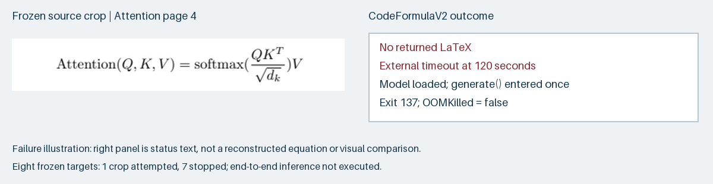

# Formula Recognition v0 — first real CPU invocation

**CodeFormulaV2 loaded and entered neural generation, but the first frozen crop
failed the 120-second time bound. No LaTeX returned. Further inference stopped.**

This is an observed **time-budget failure**, not a storage NO-GO, OOM, or measured
mathematical transcription failure. It does not establish the model's intrinsic
recognition accuracy. The eight development targets and references are unchanged;
all quality references remain `agent_visual_checked`, with zero independent human
verifications.

Parent: PR #23, `51ecf162eb23bc67271376c1dd6728d1b9dfed5c`. The
[prospective amendment](amendment.json) activates **12 GiB host reserve** and
**7 GiB inclusive allocation** for this continuation only. PR #23's 20/6 GiB
blocked result, source audit, eight reference equations and historical reports
remain byte-identical. No dependency resolution, runtime reinstall, package
upgrade, new image, license reinvestigation or alternative model occurred.

## Actual acquisition and unchanged inputs

Only the eleven registered CodeFormulaV2 runtime files were acquired/reused:
`docling-project/CodeFormulaV2` revision
**`ecedbe111d15c2dc60bfd4a823cbe80127b58af4`**. All lengths and available SHA256s
were verified. Previously unavailable small-file SHA256s were independently
computed and their complete bodies verified against the frozen Git blob SHA1s.
SHA1 was not substituted for SHA256. The original five small configuration bodies
were reused after hashing. Full actual hashes/URLs/lengths are in
[model-manifest.json](model-manifest.json).

- Weight: **630,993,616 B**, SHA256
  `4b04e77af34c4e682a7ab1617628340d658f3c3dcd12456dd2a7fff805cf79d2`.
- Runtime files total: **639,797,175 B**; new HTTP payload bodies: **639,793,392 B**.
- Host model allocation: **647,593,984 B**, measured by allocated blocks.
- One retained canonical host copy plus one isolated guest copy. No third weight
  copy, model export, cache cleanup or modification of the existing installation.
- The first transfer reached its **480-second acquisition-client deadline** after
  **417,333,248 B**. The exact remaining range was then obtained with HTTP 206 and
  a strictly validated `Content-Range`; the complete weight passed its frozen
  SHA256. Initial failure and continuation evidence remain intact. This was a
  transfer continuation, not a model retry; the inference bound stayed 120 seconds.

All registered original PDF and retained extraction hashes were rechecked.
The [original selection](../../selection.json) still contains Attention p4 scaled
dot product, p5 MultiHead/FFN, p6 positional encoding, Nature p10 weighted sum,
p11 softmax, and LoG p4 equations (2)/(4). No alternative PDF/version was used.
All eight source crops were rendered from the frozen padded boxes and scale **1.67**
using the prescribed actual-page-axis scaling and floor/ceil pixel boundaries.
[Crop freeze](crops-frozen.json) binds their sizes and hashes before inference.
Reference LaTeX was not loaded into the prediction worker.

The first crop is **387 × 61 RGB pixels**, source PNG SHA256
`9b9b3cccafa6e482c591d1ad81c52c4d7daade04b5e63a730af286b8508c1e9d`.
The engine's independently serialized PNG has a different compression-byte hash,
but its dimensions and every RGB pixel match exactly: pixel SHA256
`dd8828dd91f2d8ab74241071ec58e516d4fafa6bb6f07a7eb95e1af995410619`.
This is a verified encoding difference, not a repaired/mutated crop. Both PNGs
are retained externally; both identities are recorded in [storage.json](storage.json).

## Minimal worker and one actual invocation

The existing Linux aarch64 / CPython **3.11.13** runtime and 103-package candidate
were reused. Docling remains **2.148.0**, CPU Torch **2.15.0+cpu**, Torchvision
**0.29.2+cpu**, and the registered Heron model remains unchanged. Heron was **not
invoked** because end-to-end detection was never reached.

`worker.py` uses the audited public crop engine:
`CodeFormulaVlmModel` → `stage.engine.predict_batch([VlmEngineInput(...)])`.
The formula preset is the pinned CodeFormulaV2 Transformers path, BF16 as selected
by that preset, CPU SDPA, compilation off, `<formula>` prompt, temperature 0,
**2048 max new tokens**, special tokens retained and native repetition stopping.
The standard native cleanup would run only after an engine return; it did not run.
No limits, margins, dtype, prompt, token budget or parameters were changed after
seeing the timeout. [Effective options](effective-options.json) and the
[prediction/scorer code freeze](prediction-code-freeze.json) retain the actual configuration.

The controlled container had network **none**, a read-only root filesystem,
UID/GID 65534, dropped capabilities, no-new-privileges, no host bind mounts/socket,
read-only access to the existing candidate volume and write access only to its new
experiment volume/tmpfs. No GPU or remote service. Four Torch threads and one
interop thread were set; CPU/BLAS environment limits stayed at four. Actual kernel
limits were checked before neural imports. Each crop would have used a fresh
container, but only the first was started.

Instrumentation delegates the original engine and `generate()` implementations
unchanged. It records load/predict/generate entry and any return; no backend text
or expected formula can substitute for a neural result. The retained
[event log](first-events.jsonl) shows one load success, one predictor entry, one
`generate()` entry and **no generation success/return**. The direct crop engine
has no Docling backend-text fallback. No raw generated text, cleaned LaTeX or
partial decoded token sequence is available. Do not manufacture one from the
reference, original characters, model label or initialization messages.

| Observed first-crop quantity | Result |
| --- | --- |
| Successful model initialization | **0.571387 s**, after imports |
| `generate()` entered | **9.404327 s** after worker start |
| Generation duration observed before kill | **at least 110.615683 s**; no return |
| External watchdog deadline | **120 s**, unchanged |
| Docker start-to-exit lifetime | **120.061485 s**, including kill dispatch |
| Host wrapper wall time | **120.359178 s**, including dispatch/cleanup |
| Container exit | **137**, timeout; `OOMKilled=false`, PID 0, exited |
| Highest sampled kernel `memory.peak` | **641,531,904 B (~611.8 MiB)** |
| Exact final kernel peak | **null**; worker killed before final write |
| Last sampled OOM / OOM-kill / memory-max events | **0 / 0 / 0** |
| Sampled CPU time | **444.715395 CPU s** |
| Average sampled CPU use | **3.705 cores**, about 92.6% of the four-core quota |
| Actual `memory.max` / `memory.swap.max` | **4,294,967,296 / 0 B** |
| Actual `cpu.max` / cpuset | **400000 100000 / 0–3** |
| Cgroup samples | **1,172**, through elapsed **120.020009 s** |

The sampled high-water counter is a **lower bound on the final peak**, not process
RSS, total VM RAM or a cold-start memory bound. Weight-file caches were populated
by acquisition/hash checks and guest copying; shared page-cache charge ownership
also limits interpreting this as standalone model memory. This run supplies no
memory-exhaustion evidence. Full counters and scopes are in
[first-invocation.json](first-invocation.json); complete samples stay outside Git.

Two checkpoint warnings are preserved: deprecated `rope_scaling`, and different
embedding/head values despite a tied-weight configuration. Transformers selected
its native untied behavior. No config/weight repair was attempted, and neither
warning is established as the timeout's cause. Likewise, CPU cost, prefill/decoding
cost and possible repetition cannot be separated without a returned/streaming
sequence. No generated token count or throughput is invented.

The reused external watchdog successfully issued Docker kill at the deadline.
Its secondary attempt to signal the attached host CLI process group logged
`PermissionError`. This is preserved as a **controller cleanup warning**: the
container exited, PID is 0, and the attached CLI returned 137. No orphan inference
or retry remained. Controller-command exit 0 meant evidence collection completed;
it is **not** candidate success. The new continuation gate checks successful
worker/generation evidence before any further call and fails closed if absent.
No historical controller was silently repaired.

## Eight-target accounting and mathematical evaluation

The user's first-failure stop rule was applied. **No other crop, no end-to-end
page and no alternative model was run**, including after the generic resume
message. The remaining prepared images are inputs, not predictions.

| Frozen target | Crop scenario | End-to-end scenario | Returned LaTeX |
| --- | --- | --- | --- |
| Attention scaled dot product | **TIMEOUT** | Not executed | null |
| Attention MultiHead | Not executed after first failure | Not executed | null |
| Attention FFN | Not executed after first failure | Not executed | null |
| Attention positional encoding | Not executed after first failure | Not executed | null |
| Nature weighted sum | Not executed after first failure | Not executed | null |
| Nature softmax | Not executed after first failure | Not executed | null |
| LoG equation (2) | Not executed after first failure | Not executed | null |
| LoG equation (4) | Not executed after first failure | Not executed | null |

[Predictions](predictions.json) and [results](results.json) preserve all eight
source identities, original character references and statuses:

- Crop attempted **1/8**; completed **0/8**; timeout **1/8**; stopped/unexecuted **7/8**.
- End-to-end attempted **0/8 targets**, **0/6 unique pages**.
- Returned, correctly accepted complete formula outputs: **0**. Quality-scoreable
  predictions: **0**. This is **not “0/8 mathematical accuracy.”**
- Exact LaTeX, formatting-normalized agreement, independently verified syntax,
  symbol fidelity, fraction grouping, radical scope, scripts, sums/limits,
  delimiters/operators and complete-expression correctness are **null**.
- For every component category, correct/incorrect/missing/ambiguous counts are
  unscoreable without a generated expression. A timeout is not a demonstrated
  wrong fraction, lost sum symbol or hallucinated operator.
- Detection/localization was unexecuted, so there are no detected boxes, IoUs,
  merged/omitted formula decisions or crop-versus-end-to-end quality comparison.
- No recognized text exists to align with original PDF symbols. Existing source
  Unicode/IDs/geometry remain authoritative and unchanged; no one-to-one links
  or model-native source provenance were invented.

`scoring.py` implements a small **diagnostic relationship comparator**, with
fractions/radicals/script attachments/sum limits/delimiters/operator keys and
explicit missing/extra proposals. The exact-string normalization remains only
CRLF/CR→LF plus outer trim. Structural argument parsing is separate from that
string metric. It is not a TeX macro expander, trusted syntax checker, general
mathematical AST or proof of semantic equivalence; unsupported parses remain
unscoreable. Unit tests exercise grouping/script mistakes and null predictions.
No actual mathematical scores were obtained, and no threshold was tuned.

Tectonic is installed, but no generated LaTeX exists to compile/render. Thus no
predicted rendering or independently checked syntax is claimed. The figure below
is explicitly **source plus failure status**, not a predicted-equation comparison.

## Storage, preservation and reproducibility

The [storage ledger](storage.json) covers prior runtime/setup/model/cache/evidence
roots plus new host model, VM allocation, inputs/outputs and temporary evidence.
Guest layers/files are already in the sparse VM's host blocks and are not added
again. Download sizes are not treated as installed/physical allocation.

Highest sampled inclusive allocation: **6,707,945,472 B (~6.25 GiB)**, below
**7,516,192,768 B**. Lowest sampled host availability:
**17,114,333,184 B (~15.94 GiB)**, above **12,884,901,888 B**.
Final snapshot availability: **18,186,133,504 B (~16.94 GiB)**; background changes
mean this increase is not experiment cleanup or recovered-space evidence. Guest
free space: root **2,123,157,504 B**, Docker data **1,946,935,296 B**. No disk resize,
uninstall, cache prune or historical deletion was used.

These are periodic block-allocation observations with a guarded 128 MiB work
margin and conservative admission, not continuous/exclusive APFS high-water
measurements. Small subsequent report/publication copies are accounted in the
external final snapshot. Historical provisioning peak remains UNKNOWN.

All **481 pre-existing tracked files** remain byte-identical. Existing Colima
configuration and Docker context match their before hashes/values; every owned
container is exited and the existing VM is preserved. Original PDFs/extractions,
references, Source Selection, Hybrid, viewer, Inspector and production parser are
unchanged. No new research dependency, LLM service, OCR or document upload.

[Commands](commands.md) and content-hash manifests reproduce analysis independently
of predictions. **594 offline tests passed**, zero failures/skips, including **26 new cases**.
The exact-head CI result is recorded with publication. One initial safety-test fixture incorrectly expected Linux
`sched_getaffinity` on macOS; only the mock was corrected before inference.
This was a test-portability issue, not a candidate repair or quality regression.
All inference code and diagnostic scoring code stayed hash-frozen after the call.

## Eight answers and next decision

1. **Load and execute on ARM64 CPU?** Yes: model initialization completed and real
   predictor/`generate()` execution began. **No completed recognition.**
2. **Time/memory?** Load 0.571 s after imports; generation ran at least 110.616 s
   before the 120 s invocation deadline; observed memory high-water ≥611.8 MiB,
   exact final peak unavailable; no OOM-kill evidence. See the scopes above.
3. **How many formulas attempted?** **1/8**, then **7/8 stopped**. End-to-end 0/8.
4. **How many correctly recognized?** **Zero returned/accepted outputs**; actual
   mathematical correctness remains **unmeasured**, not an eight-formula failure rate.
5. **Which components failed?** None can be classified mathematically. The
   observed failure is completion latency, not demonstrated fraction/radical/CID
   sum/index corruption. The LoG unresolved-glyph cases were not attempted.
6. **Crop versus end-to-end?** Unknown. Oracle crop recognition itself timed out;
   no detection experiment ran. No detection/transcription advantage is inferred.
7. **Build Formula Structure v0 now?** **No, not from this candidate/run:** there is
   no recognized LaTeX to support an AST. String generation, trusted syntax,
   mathematical structure and source-symbol alignment remain separate capabilities.
   This does not show the model is intrinsically inaccurate or that all CPU
   configurations would fail.
8. **PP-FormulaNet-S comparison justified?** **Yes, as a separately authorized
   resource/latency feasibility comparison**, not as an established accuracy winner.
   First verify a pinned official model/license and ARM64 CPU runtime within the
   remaining 7 GiB budget without altering Docling; retain the same four-core,
   4 GiB/no-swap/120-second controls. If its dependencies cannot fit, stop and
   report the budget gap. No second model was acquired or executed here.

**Stop after this recorded first-failure outcome. No longer timeout, retries,
additional formulas/pages, production AST/parser, explanation or Inspector integration.**
