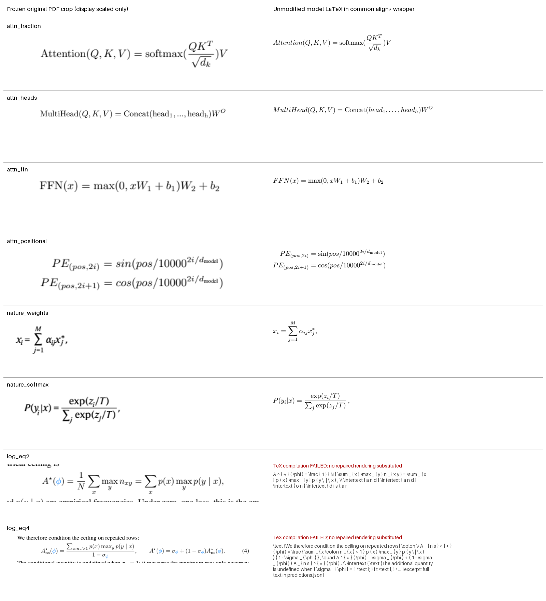

# Formula recognition on an existing Colab T4 — 2026-11-16

**First measurable neural results:** CodeFormulaV2 returned outputs for all eight frozen crops. Seven reached EOS; one was incomplete after the native repetition stopper. No timeout, OOM, fatal inference error or environment correction occurred. Under the explicit provisional source-review policy, **4/8 selected expressions have complete mathematical content and source-sensitive notation**, three have identified whole-output problems and one remains incomplete/unknown. These are development-exposed, agent-checked observations, not independently validated accuracy.

PP-FormulaNet-S did not reach recognition: its separate PaddleOCR environment failed during import with an NCCL symbol error. It has **0/8 attempted formulas**; no quality comparison or model winner is supported.

## Identity and separation from CPU experiments

Stacked on PR #25, commit `47c1e560719b2b4f601449f509ef674689b887ba`. The same eight original PNG crops (60,172 B total) were located outside Git and verified against every frozen SHA-256 and byte count before transfer; Colab verified them again. No PDF regeneration, alternate crop, new layout detection, reference upload or prediction repair occurred. Original PDF hashes, pages, target boxes, 1.67 rendering scale and floor/ceil pixel geometry remain in inference-inputs.json and the unchanged historical selection.

CodeFormulaV2 remains `docling-project/CodeFormulaV2@ecedbe111d15c2dc60bfd4a823cbe80127b58af4`. All eleven runtime files were acquired directly on Colab and checked against the prior lengths/hashes, including weight SHA-256 `4b04e77af34c4e682a7ab1617628340d658f3c3dcd12456dd2a7fff805cf79d2`. The 639,797,175 B model payload was not downloaded again to the Mac. Checkpoint configuration/weights were not edited.

New prospective GPU configuration: Tesla T4 (SM 7.5), **FP16**, greedy generation, seed 0, batch one, 2,048-token cap, compile disabled, SDPA, no flash-attention dependency, unchanged default repetition stopper. FP16 is passed through Docling's engine options and all floating model parameters were verified float16. BF16 checkpoint metadata is preserved. Each crop runs in a fresh process with a **180 s external watchdog**; no warm-batch throughput is claimed. Deterministic generation was configured; bitwise repeatability was not tested.

The existing Colab session `understanding-engine` was reused, never created/restarted/stopped. Requested SSH `nvidia-smi` returned HTTP429 because another SSH connection was active; it was not terminated. Official CLI 0.8.0 `exec` ran nvidia-smi and work instead. One exec transport disconnect happened before any remaining crop started; read-only markers proved this, and only seven unstarted crops resumed. No formula retry occurred. Ground-truth LaTeX stayed local until the separate evaluation stage.

## Runtime and resource observations

The preinstalled CUDA stack was preserved: Python **3.13.16**, Torch **2.14.1+cu130**, torchvision **0.29.1+cu130**, Transformers **5.22.1**, CUDA 13.0, driver 580.82.07. Docling/Docling-slim **2.148.0** and required additions were installed into a new system-package-sharing venv from inspected hash-pinned locks. The active versions are recorded explicitly (unfiltered distribution inventories contained stale/duplicate metadata). Actual CodeFormula stage, Transformers engine and preset source hashes match the retained 2.148.0 source audit.

Standard venv lacked ensurepip; existing uv created the isolated environment. The uv resolver could not satisfy the visible vendor Torch build; pip recognized the installed CUDA packages, and the accepted plan replaced neither Torch nor Transformers. No host research dependency, existing Linux installation, Colima profile or CUDA base package was modified. These GPU runtime/dtype differences mean this is not a controlled hardware-only speedup measurement against the historical CPU timeout.

| Observation | Measured value |
|---|---:|
| Engine/model initialization per process | 1.479–1.907 s |
| Recognition per crop | 2.543–15.350 s |
| Recognition total / mean | 43.686 / 5.461 s |
| Maximum PyTorch allocated VRAM | 1,031,519,744 B (983.7 MiB) |
| Maximum PyTorch reserved VRAM | 1,182,793,728 B (1,128 MiB) |
| Maximum process RSS | 2,106,109,952 B (1.96 GiB) |
| External timeouts / OOM / fatal inference errors | 0 / 0 / 0 |

Allocated/reserved VRAM are PyTorch allocator measurements, not a measured peak for every CUDA library or the whole device. T4 physical memory is about 15 GiB. Colab did **not** inherit the earlier local Linux 4-GiB cgroup/zero-swap/four-core quota enforcement; no such equivalence is claimed. PyTorch intra-op threads=4, inter-op=1; RSS is measured. Offline Hub/Transformers flags disable artifact fetching during inference; no kernel network namespace isolation is claimed.

Remote experiment allocation was **782,327,808 B** after CodeFormula, **7,630,086,144 B (7.11 GiB)** after the optional Paddle setup, including its retained 1,977,882,736 B wheel. Remaining remote free space was 113,108,430,848 B. These are directory allocation snapshots excluding preinstalled VM packages; transient installation peak is UNKNOWN. Remote cloud allocation is reported separately, not asserted to fit or amend the historical **7 GiB local CPU** budget. No fixed remote storage cap was supplied for this GPU run. The Mac already had only 12,109,086,720 B free (11.28 GiB) before execution, below the historical local 12-GiB reserve. Only small evidence was downloaded locally; **local deployment reserve readiness is not established**. No cleanup, host model installation or alteration of historical resource conclusions occurred.

## Frozen quantitative and visual review

| Frozen target | Recognition s | Generated tokens | Termination | Provisional source review |
|---|---:|---:|---|---|
| attn_fraction | 4.646 | 62 | EOS | Correct content |
| attn_heads | 3.296 | 65 | EOS | Correct content |
| attn_ffn | 2.574 | 56 | EOS | Correct content |
| attn_positional | 4.787 | 119 | EOS | Correct content |
| nature_weights | 2.543 | 51 | EOS | Notation loss |
| nature_softmax | 2.896 | 63 | EOS | Notation loss |
| log_eq2 | 15.350 | 432 | Repetition stop | Incomplete; unknown |
| log_eq4 | 7.594 | 213 | EOS | Malformed + prose |

Exact spelling: **0/8**. Unchanged frozen formatting normalization (strip + line endings): **0/8**. These string measures are convention-sensitive and do not establish mathematical incorrectness. Native raw output, official cleaned output, token IDs/termination, crop hash and resource provenance are preserved. No BLEU score or algebraic equivalence claim is made.

A common `align*` display wrapper compiled **6/8** unchanged bodies using the existing Tectonic installation in cache-only, untrusted mode. This provides rendering context for alignment markers; it does not repair any generated symbol/group. Both LoG outputs fail with unclosed groups. Successful compilation is a syntax/rendering observation, not semantic proof.



The source-review policy tolerates math whitespace and named-function typography, but preserves meaningful bold-vector notation. The four Attention expressions retain their fractions/radical, visible indices, operators and both positional-encoding lines. The Nature formulas lose three inspected bold-vector x glyphs. LoG (2) recovers its formula core but generates repetitive prose; native stop_sequence/repetition termination lacks EOS and leaves official cleaned LaTeX incomplete. LoG (4) reaches EOS with both formula parts visible but also surrounding/hallucinated prose and an unclosed intertext group. The latter is an incorrect whole output; the former's whole-expression mathematical correctness is null, **not relabeled incorrect because of truncation**.

| Enumerated source-checked core components | Correct | Incorrect | Missing | Ambiguous | Unscoreable | Denominator |
|---|---:|---:|---:|---:|---:|---:|
| Fraction membership | 4 | 0 | 0 | 0 | 0 | 4 |
| Radical scope | 1 | 0 | 0 | 0 | 0 | 1 |
| Ordinary subscript attachment | 24 | 0 | 0 | 0 | 0 | 24 |
| Ordinary superscript attachment | 9 | 0 | 0 | 0 | 0 | 9 |
| Summation operators | 5 | 0 | 0 | 0 | 0 | 5 |
| Summation limits (separate from ordinary scripts) | 6 | 0 | 0 | 0 | 0 | 6 |
| Delimiter groups | 22 | 0 | 0 | 0 | 0 | 22 |
| Inspected font-sensitive vector glyphs | 0 | 3 | 0 | 0 | 0 | 3 |
| LoG star versus asterisk exact identity | 0 | 0 | 0 | 4 | 0 | 4 |
| Frozen alpha-reference conflict | 0 | 0 | 0 | 0 | 1 | 1 |

These enumerated local relations include visible formula cores in incomplete/contaminated outputs; they **are not whole-expression accuracy**, exhaustive glyph error counts, or new independent references. Full raw comparison/scorer limitations remain in results.json, including unsupported lightweight parses. Extra repetitive/hallucinated prose is recorded as whole-output failure, not discarded to manufacture a clean prediction. Named-function typography differs in the Attention outputs; exact visual identity is not claimed.

**Reference issue:** frozen Nature weighted-sum LaTeX contains Latin `a_{ij}`, but the prior source-symbol reference and native character `…:p10:c4242` explicitly contain `α`. The crop also supports alpha, and the model emits alpha. Frozen references remain byte-identical; this glyph's frozen-reference comparison is unscoreable, not a model substitution error. See reference-discrepancies.json. All current reviews remain `agent_visual_checked`; independent human verifications=0.

## Optional PP-FormulaNet-S: isolated setup failure

Pinned model identity remains `PaddlePaddle/PP-FormulaNet-S@0572450e501be9eb1b1cdb7e00fccf4b22fab4df`, declared Apache-2.0. **No PP weights were acquired** after setup failed. Official Paddle GPU 3.3.1 CUDA-13 CPython-3.13 x86_64 wheel exists. Its 1,977,882,736 B payload was independently hashed (`dc920c514987a235ed1a54c6d2d3d82a9b8d8f056253a9fb80cc8fd2a176ac45`); the official index supplied no expected whole-wheel hash. ZIP metadata declared 3,057,281,788 B unpacked. PaddleOCR 3.7.0 / PaddleX 3.7.2 and their hash-pinned dependencies were installed only into `pp-runtime`; base libraries were not uninstalled.

Paddle reports CUDA compiled and one GPU, but `from paddleocr import FormulaRecognition` fails:

```text
PaddleOCR -> PaddleX -> ModelScope -> torch
ImportError: libtorch_cuda.so: undefined symbol: ncclCommResume
```

The PP environment pins NCCL 2.28.3 while base Torch uses 2.30.7. Loading both stacks in the same PP process gives the observed symbol incompatibility. No ABI workaround, package replacement or second environment retry followed the fatal import. A separate CodeFormula process still imports its original versions and executes a one-element CUDA probe successfully; no model rerun was needed. PP: **0/8 attempted, 8/8 unexecuted**, all recognition/quality/latency/VRAM metrics null. It is not shown to be worse or better at mathematics. A future fully isolated PP environment without visible Torch may avoid the opportunistic ModelScope import; this remains untested.

## Decision and boundaries

1. **Does CodeFormulaV2 produce correct LaTeX on T4?** Yes for several inspected formulas; six snippets render, with four provisionally source-faithful mathematical expressions under the stated typography policy.
2. **How many fully correct?** 4/8 selected; three identified whole-output problems, one incomplete/unknown. This agent judgment is not independent human ground truth.
3. **Which components fail?** Bold-vector notation, formula-only output containment, repetitive/prose generation and group closure. Exact LoG star glyphs remain ambiguous. The tested fraction/radical/attachment cores are promising, including native-PDF-unmapped summations; model output does not retroactively recover authoritative Unicode.
4. **Costs?** Recognition 2.54–15.35 s; peak allocator VRAM about 984 MiB, reserved 1,128 MiB, RSS 1.96 GiB. Initialization and per-process overhead are separately retained.
5. **Is PP better?** Unknown; its runtime import failed before a neural call.
6. **Begin Formula Structure v0?** Justified as a small research prototype on explicitly fallible, complete predictions, with syntax/containment checks and unresolved nodes. Not justified as trusted automatic mathematics or explanations. LaTeX generation, syntax parsing, mathematical AST construction and original-symbol alignment remain separate capabilities.
7. **Local obstacles?** The Mac lacks a CUDA T4; ARM64 CPU latency remains unresolved, local storage reserve is below its prior gate, and Paddle/Torch native dependencies conflict when mixed. This GPU result does not establish a local deployment path.

No one-to-one source-symbol alignment was produced: predictions retain original PDF/page/crop provenance, not manufactured source character links. No new detection benchmark, reference correction, production API change, AST implementation or GUI work occurred. All historical experiments/CPU conclusions and previous tracked files are preserved. Essential remote evidence was downloaded; package/model payloads and private paths remain outside Git. Offline regression and exact-head CI results are recorded in validation.json / the PR. **The existing Colab session remains running; release it manually after reviewing the downloaded evidence.**

Validation: **637 offline tests passed in 20.15 s**, zero failures/skips; all **525 pre-existing tracked files** remain byte-identical. The 22 new model-free tests cover identities, no-reference manifests, duplicate-start guards, incomplete termination, reference discrepancy visibility and deterministic evaluation without mutating predictions. CI is reported against the published commit on the PR.
