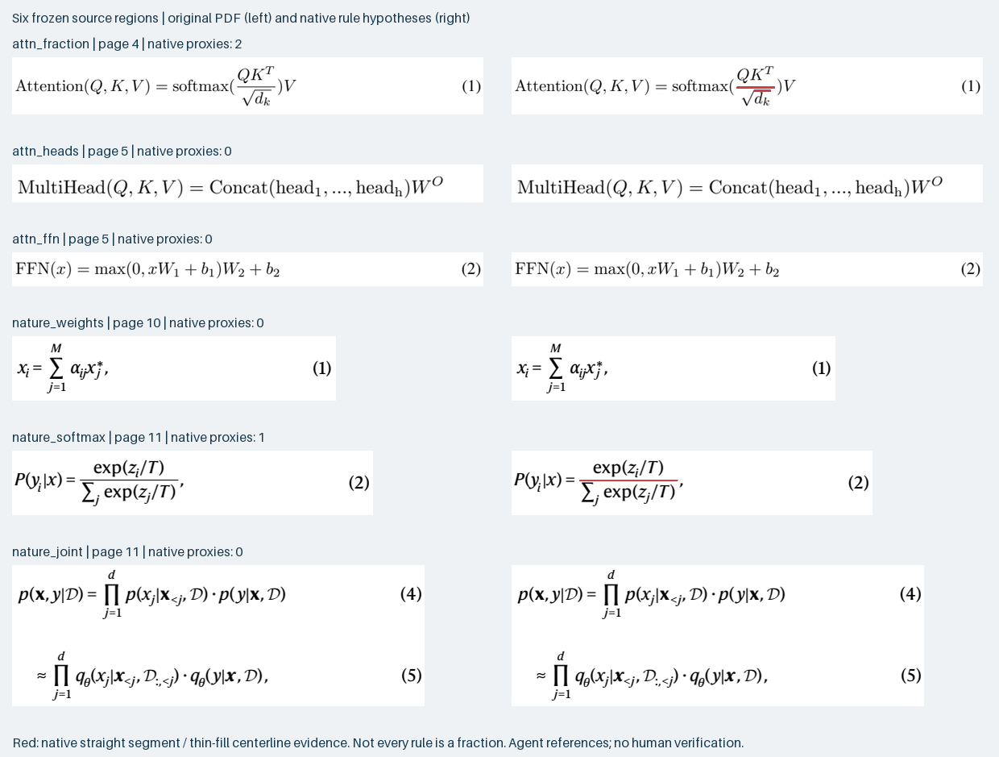

# Native PDF Math Evidence v0

**Native PDF vectors reproduce the useful SVG rules on the two exposed control
equations. A separate bounded font resolver recovers their three missing sum
identities diagnostically. Neither result establishes a reliable math parser.**

The six new component-level examples show one useful fraction/summation improvement
and a radical-overbar regression. Keep original characters authoritative. The
smallest justified future addition is an **optional native-evidence sidecar**,
not corrected source Unicode, inferred formulas, or a production parser change.

## Protocol and input identities

This offline feasibility experiment is stacked on PR #21, commit
`4d05592122db216ff3a7c6d629ae38afdc0552e0`. It imports that experiment's
`reconstruct.build`, thresholds, `source_units` and exact-ID-set scorer unchanged.
The old equation (2)/(4) reference is read-only, with hash
`0e971de249c2deb5fbf0fe1da8a6871b0c9f6eb6379a4d70c8cdeda4a211fd10`.
[Freeze](freeze.json) verifies all four parent files and the new component reference
hash before execution. Labels load only **after predictions are saved and hashed**.
Font diagnostics never enter the reconstruction inputs.

[Input manifest](input-manifest.json) binds these already available files and
their retained, independently hashed extraction caches:

| Development document | PDF SHA256 | Pages used |
| --- | --- | --- |
| User-confirmed LoG final-preview PDF | `ad6d6d00a432f2f7e2e3b1c77a5e4ef80ecf2080300713d1c680de1f3fd79060` | 4, exposed controls only |
| Attention Is All You Need, v7 | `bdfaa68d8984f0dc02beaca527b76f207d99b666d31d1da728ee0728182df697` | 4, 5 |
| Nature TabPFN, registered publisher PDF | `6b5ce3dba2ef7454ad0868ad733a64b4ac89bcd98307773fad1e0e977caaa013` | 10, 11 |

No source was downloaded, converted or modified. SVG control C reuses only the
hash-verified retained PR #21 rule evidence; no ZIP re-conversion or new SVG is
generated. Full PDFs, source caches, page sidecars and raw predictions stay outside
Git. [Commands](commands.md) reproduce the stages using existing packages.

## Native evidence adapter

`native.adapt` verifies the PDF byte hash, unchanged extraction settings, page
geometry, every original character ID/index, Unicode, box, matrix, font and size
on the selected pages. It rejects unsupported rotation/crop/UserUnit frames rather
than guessing a transform. It retains the original ordered character-ID references
and separate native line/rectangle/curve records.

The pinned pdfplumber backend converts `.pts` and `.path` into its TOPLEFT frame
in `Page.process_object`; raw bottom-origin boxes are retained independently.
Native primitive IDs bind PDF hash, page, object kind and backend index. They do
not invent content-stream offsets, ink visibility, character membership or math
semantics. Curves and out-of-page geometry remain in the sidecar. Clipping and
occlusion are **not** verified by the backend; a drawing record is evidence, not
proof of visible ink. [Selected examples](native-examples.json) retain complete
original primitives/provenance alongside their derived proxies.

Rule proxies use a policy frozen before evaluation: actual stroked `m/l/h`
segments; no curve chords. A filled rectangle at most 1 point thick, at least
2 points long and aspect ratio at least 20 yields a **centerline hypothesis**.
Its original area is retained. This handles Nature's filled rule without changing
the frozen reconstruction algorithm's line-slope criterion. No proxy is labelled
a fraction in the adapter. Every eligible proxy inside each frozen region is
supplied, including the Attention radical overbar; no reference-aware filtering.

## Phase 1: exposed LoG controls

All configurations use the exact same original character inputs:

- **A / `characters`:** original characters only.
- **B / `native_vectors`:** original characters plus native rule proxies.
- **C / `retained_svg`:** original characters plus the retained SVG rules.

| Measure across equations (2) and (4) | A | B | C |
| --- | ---: | ---: | ---: |
| Exact full numerator/denominator membership | 0/2 | **2/2** | **2/2** |
| Correct script links | 14/17 | 14/17 | 14/17 |
| Incorrect script proposals | 3 | 2 | 2 |
| Operator/lower-index/summand sum sets | 0/3 | 0/3 | 0/3 |
| Delimiter pairs | 9/9 | 9/9 | 9/9 |
| Region equation-number ID sets | 2/2 | 2/2 | 2/2 |

Both A and C reproduce PR #21's original decisions. **B and C have identical
character grouping, fraction membership, script, operator, order-independent
expression-part and number decisions**, ignoring their intentionally different
provenance IDs and floating bar coordinates. Rule-coordinate maximum differences
are **0 points** in (2) and **1.1368683772161603e−13 points** in (4).
Exact membership lists and wrong proposals are retained in [results](results.json).
This is controlled reproduction, **not independent validation on those equations**.

## Phase 2: bounded font-name diagnostics

The resolver identifies a unique page/Form font resource matching the original
font name, requires simple embedded Type1, checks BaseFont/descriptor/program-name
identity and a recognized static Encoding grammar, and records font/header/CMap
SHA256s. It refuses conflicting bindings, multiple distinct matching resources,
existing CMap contradictions and explicit PDF Encoding overrides. Font and CMap
streams are bounded before decompression (1 MiB / 64 KiB); only unfiltered or
single-Flate streams are supported. No PostScript program is executed.

Only four standard math glyph names (`summation`, `product`, `integral`, `radical`)
and two specifically enabled CMEX10 names (`summationdisplay`, `summationtext`)
map to diagnostic Unicode. **The code is resolved through that font's own static
encoding; CID numbers are never a global Unicode table.** Neither coordinates,
references nor equation meaning determine glyph identity. Declared names are
evidence, not proof of arbitrary/adversarial outline shapes.

Observed [glyph results](glyph-results.json):

- **3/3 target LoG sum identities** resolve diagnostically to U+2211. Six unresolved
  sum units on the inspected LoG page resolve in total; the other three are
  supplementary diagnostics, not extra benchmark examples.
- Every original `(cid:88)` / `(cid:80)` string and source ID is unchanged.
  The extra Unicode is explicitly diagnostic, not a replacement in extraction.
- The one unresolved Attention footnote unit has native name `summationtext` in
  **CMEX9**. This version deliberately abstains because that family variant is not
  enabled. Its identity evidence is retained. “Unrecoverable” here means **not
  resolved by this bounded implementation**, not irretrievably lost from the PDF.
- No unresolved CID/replacement units occur inside the six selected new expressions.
  There is therefore **no new-formula positive test of glyph recovery**. Actual
  ambiguity count is zero; synthetic tests exercise conflicting encodings/CMaps,
  resource collisions and cross-font reuse of the same CID. Type0/CID, Type3,
  unembedded fonts and general encoding overrides are not supported.

Thus the original PDF contains enough metadata for **this bounded CMEX10 recovery**.
Broader deterministic Unicode recovery remains unvalidated. Diagnostic Unicode is
not fed into A/B/C, so their unresolved sums are not silently “fixed” and geometry
and glyph effects are not confounded.

## Phase 3: six frozen new component references

[Reference](reference.json), [regions](regions.json) and the initial freeze were
written before the first candidate reconstruction. Original PDFium renders were
visually inspected. All references are **agent_visual_checked**, with **zero
independent human verifications**; quality measures are provisional.

The documents were already used in development. [Exposure audit](exposure-audit.json)
finds no intersection with prior frozen annotation boxes. Attention page 4 was
previously seen in a layout experiment, whose boxes exclude this formula. These
are **new mathematical component evaluations**, not pristine unseen pages,
unseen papers, held-out data or independent human validation. The old LoG equations
are excluded from all six-example aggregates.

The selection covers a radical denominator, superscripts/subscripts, lower and upper
sum limits and a two-line density factorization. **It contains no stacked nested
fraction**; inner slash divisions and a radical are not relabelled as nested
fractions. A synthetic nested-fraction stress test records the frozen solver's
existing limitation. This is a real coverage gap, not a claimed success.

| New expression | Fraction A → B | Script links A → B | Important observation |
| --- | ---: | ---: | --- |
| Attention p4, scaled dot product | 0/1 → **0/1** | 2/2 → **1/2** | Radical overbar causes two wrong fraction proposals |
| Attention p5, MultiHead line | none | 1/3 → 1/3 | Multi-letter `head` base grouping remains wrong |
| Attention p5, FFN | none | 4/4 → 4/4 | No rule needed; no change |
| Nature p10, weighted sum | none | 4/6 → 4/6 | Sum lower-index/summand set already recovered; not every script |
| Nature p11, softmax | 0/1 → **1/1** | 3/4 → **4/4** | Thin filled rule isolates numerator and denominator |
| Nature p11, joint density, two lines | none | 10/11 → 10/11 | Products, multiline grouping and numbering unresolved |

| Six-example aggregate | Characters | Characters + native vectors |
| --- | ---: | ---: |
| Correct exact fraction groups | 0/2 | **1/2** |
| Incorrect fraction proposals | 0 | **2** |
| Correct script links | 24/30 | **24/30** |
| Incorrect script proposals | 7 | **4** |
| Sum operator/lower-index/summand sets | 1/2 | **2/2** |
| Correct delimiter pairs | 8/14 | **10/14** |
| Incorrect delimiter proposals | 9 | **7** |
| Explicit arithmetic/comparison token IDs | 14/19 | 14/19 |
| Expression-part membership sets | 2/7 | 2/7 |
| Region number-ID set equality | 4/6 | 4/6 |

Fraction proposal precision is **1/3** for B (one correct, two wrong), recall **1/2**.
A makes no proposals, so its proposal precision is null, not 0/0 success.
The script net is unchanged: **Attention 7/9 → 6/9**, **Nature 17/21 → 18/21**.
Sum scores follow PR #21's exact operator/lower-index/summand definition;
upper limits are graded separately as script links. They do not establish complete
sum semantics, domain interpretation or correct upper limits.

The number metric retains PR #21's one exact ID-set decision per region, including
an expected empty set for the unnumbered MultiHead line and a union of both labels
for the density region. It is not six independently detected equation labels.
Unsupported glyph operators such as `/`, `⋅`, `≈` remain visible misses under the
unchanged token recognizer. Zero-reference metrics are null ratios.

### Observed failure mechanisms

The narrow radical rule is processed before the true Attention fraction rule.
It consumes an incorrect subset; subsequent grouping fragments the true numerator
and radical denominator. Both primitive paths are genuine PDF evidence—the error
is **role/hierarchy inference**, not missing vectors. No overbar filter was tuned
after observing this regression. The synthetic nested case likewise preserves
units but fails to nest a complete inner fraction in the outer numerator.

Nature's actual fraction is a filled rectangle, not a stroked line. Retaining its
area and exposing an explicit centerline lets the unchanged solver correctly group
9 numerator and 11 denominator units and isolate the denominator summation.
Column-relative equation numbering is still unsupported: the frozen page-width
heuristic misses the left-column number. Multiline density/number ordering, products,
radicals, implicit multiplication, function/identifier grouping and mathematical
equivalence remain unresolved. Full formula correctness is **null**, not inferred
from a few correct relationships.

All 327 selected original units (98 control + 229 new) remain conserved per
candidate. Strong traceability is compatible with incorrect structural hypotheses.
The following sheet shows original crops and all native rule proxies; red lines
are **not** asserted fractions. Full page renders are not committed.

## Reproducibility, tests and boundaries

Two runs reproduce all nine deterministic prediction/result/native/font artifacts
**byte for byte**, excluding timing metadata. The first full experiment took
**19.646 s**, including JSON loading, contract/native-character validation,
font diagnostics, reconstruction and writing. Whole-process peak was
**590,528,512 bytes (~563 MiB)** on the measured Mac; this is not per-query or
per-formula memory. Individual measured timings and versions are retained externally.
This is not a performance/generalization claim across documents.

**551 offline tests passed**, zero final failures/skips, including **23 new
regressions**. Tests cover immutable IDs/Unicode, byte-identical sidecars, native
curves retained without chords, rectangle provenance/centerlines, malformed source
and ROI identities, rotation rejection, font-specific same-CID differences,
ambiguous encodings/resources/CMaps, decompression bounds, unsupported font families,
frozen parent hashes, nested-fraction limitations and prediction-before-reference
loading. One initial test fixture had a stale font header length; fixing the fixture
exercised the intended name-conflict check. No candidate, reference or threshold
was adjusted to improve observed quality.

All **442 pre-existing tracked files** remain byte-identical. Original PDFs/caches,
historical reports/annotations and held-out data are untouched. Existing compatible
CPython 3.11.13 and locked dependencies were reused; no packages/models/services,
SVG generation, OCR, LLM or new inference. The existing broken launcher is not
repaired; the no-project/frozen invocation caveat is documented. CI remains the
existing offline suite and its exact-head result is recorded in the PR.
No Source Selection, Hybrid, viewer, Docling, Colima or production behavior changes.

## Architectural recommendation and five answers

1. **Can native vectors replace useful SVG geometry?** Yes for the two control
   rules and their reproduced outcomes; no conversion is needed. This does not
   prove reliable formula reconstruction or universal equivalence of drawing APIs.
2. **Can embedded metadata resolve missing glyphs?** Yes diagnostically for 3/3
   target CMEX10 sums with unique static font evidence. General CID/font recovery
   is not established; the CMEX9 abstention and unsupported formats remain explicit.
3. **What improves on new formulas?** Nature softmax gains its exact fraction,
   one script link and correct denominator sum grouping. Attention regresses;
   total script correctness stays 24/30 and only 1/2 fractions is correct.
4. **What remains unresolved?** Rule roles/overbars, nested fractions, some scripts
   and identifiers, products/radicals, multiline/column numbering, implicit operations
   and full mathematical semantics. No complete-equation accuracy is claimed.
5. **Smallest justified contract addition:** a separate optional, versioned
   `native_evidence.json`, bound to PDF/extraction hashes and verified page geometry,
   containing primitive IDs/kinds/paths/boxes/stroke/fill and backend provenance.
   Derived rule proxies must preserve their original primitives and hypothesis basis.
   An optional separate glyph-diagnostic list can reference original IDs, retain
   original CID strings, and carry declared glyph names/diagnostic Unicode/status
   with font-resource and stream hashes. Do **not** make inferred fractions or
   corrected Unicode authoritative, and do not change the existing character schema.

Next justified research is independent review plus a small, frozen set emphasizing
overbars/nested fractions and column/multiline cases, with native primitives as the
input. That work and any production/Contextual Inspector integration are **not**
implemented or executed here.
