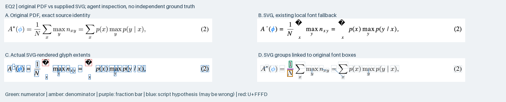
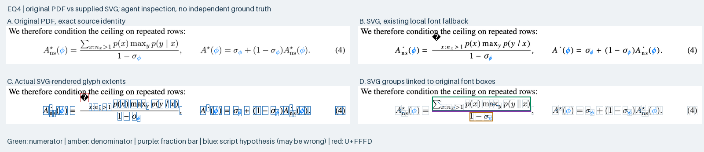

# SVG mathematical geometry feasibility — 2026-11-15

**Decision: retain the original PDF character layer. Do not integrate this
CloudConvert archive as a required/authoritative parser. Keep SVG as optional
research geometry evidence; first test whether native PDF vectors provide the
same benefit with less conversion and provenance overhead.**

This is an offline, controlled development example, not an independent benchmark.
Two PDF-render-checked references are **agent_visual_checked**, with **zero
independent human verifications**. No statistical generalization is established.

## Inputs and version correspondence

The originally requested `LOG2026_arxiv_source_clean_preview.pdf` was absent.
The discovered `LOG2026_arxiv_final_preview.pdf` was used **only after the user
explicitly confirmed it**. Both originals remain unchanged, outside this Git
repository in the surrounding project directory; neither is committed.

| Immutable input | Bytes | SHA256 |
| --- | ---: | --- |
| Confirmed final-preview PDF, 30 pages | 1,336,567 | `ad6d6d00a432f2f7e2e3b1c77a5e4ef80ecf2080300713d1c680de1f3fd79060` |
| Supplied ZIP, 30 SVGs | 1,250,816 | `ae089bf6db882d2f023fb0d6386ebd412a4d3f4705bd781f3d0df3f9ea0b4f8d` |

[Input manifest](input-manifest.json) records every member's SHA256, compressed
and expanded byte count, dimensions/viewBox, page mapping, original extraction
hash/settings and provenance. Total expanded SVG bytes: **5,739,992**. Every SVG
has dimensions/viewBox **612 × 792 / `[0,0,612,792]`**. PDF frames were checked:
zero rotation, origin zero, full media/crop/layout frame, UserUnit 1.

Page matching does **not** rely on filenames/title/page number alone. Explicitly
documented ASCII-alphanumeric seven-gram sets retrieve candidate pages; original
glyph baseline anchors then check geometric correspondence. The retrieval filter
is **identity evidence only**, never Unicode normalization or an accuracy score.
All 30 pages map uniquely to the same-numbered PDF page, with no detected shifts.
ASCII fingerprints of pages 1–3 agree exactly. The actual PDF and SVG page 1 both
contain the publisher-style citation. The earlier acceptance-note discrepancy
belongs to an **unavailable other PDF revision**, not a demonstrated mismatch in
this explicitly approved pair.

This does not certify whole-page semantic/visual equivalence. Examples of global
position/text conflicts are ligature granularity: original single glyph units
containing `fi` (227), `fl` (13), or `ff` (4) become multiple SVG code points.
Those 244 expansions account for 95,968 original units versus 96,212 SVG text
units. Anchor-only matching exposes conflicts/unmatched continuations instead of
fabricating one-to-one character links. Both layers retain 176 literal whitespace
units; much remaining spacing is encoded by coordinates, not space characters.

**Accuracy comparisons are limited to the approved equation regions on page 4**:

- Equation (2): complete region `[200,373,506,404]`, formula
  `[200,373,412,404]`, separate number `[492,380,506,393]`.
- Equation (4): complete region `[147,551,506,584]`, formula
  `[147,551,465,584]`, separate number `[492,564,506,576]`.

Both original/SVG renderings were inspected before the first reconstruction;
all 98 units, including numbers, uniquely align geometrically. All nonreplacement
formula symbols agree. The three missing mathematical identities coincide with
native CMEX glyphs whose Unicode maps are incomplete. These two regions are
comparable; **0/2 are unscoreable for version mismatch**. Whole-document parsing
accuracy and comparison with the absent clean-preview revision remain unmeasured.
The runner requires hash-bound region comparability approval; an unknown/mismatched
region is unscoreable, retaining all reference denominators.

## Printed equations and separate representations

The original PDF was rendered using existing PDFium and checked visually, rather
than accepting typed mathematics as truth. [Frozen reference](reference.json)
contains original IDs/Unicode/font boxes, visual symbol labels and separate
fractions, scripts, delimiters, operators, summands, multipart membership and
equation numbers. Its hash was frozen **before SVG equation analysis and candidate
reconstruction**. Transcriptions there are diagnostic, not authoritative source
text or verified LaTeX.

Equation (2) has `A` with a star, a `1/N` fraction, two summations each with lower
`x`, two `max` operators with lower `y`, `n` with lower `xy`, and an equality to
the probability-form expression. Equation (4) has a fraction whose numerator is
a constrained summation `x : n_x > 1`, denominator `1 − σ_ϕ`, starred/subscripted
`A_ns`, and a second equality relating the conditional and original ceilings.
Its `max` lower `y` is beside the operator; nested `n_x` and `σ_ϕ` are explicit
reference components. Equation numbers are not part of either expression.

Three inputs are kept distinct:

1. **A: original PDF rendering/native evidence.** The embedded font renders sums
   correctly. Native PDF character and line geometry is inspected read-only.
2. **B: SVG Unicode and primitives.** Text is preserved as supplied, including
   U+FFFD. Paths are not interpreted as missing glyphs by default.
3. **C: unchanged deterministic extraction.** The original parser is reused with
   its frozen settings (`x_tolerance=3`, no normalization/repair). Target native
   Unicode, backend indices, matrices and boxes match **98/98** original backend
   units exactly; no new IDs are substituted. Full extraction stays external.

The same prototype runs on SVG alone, source characters alone, and original
characters plus SVG bars. The latter preserves original Unicode/IDs; it does not
replace CIDs with guessed sums. An additional font-header diagnostic is separate
from all three candidates.

## SVG structure, rendering and safety

[SVG inspection](svg-inspection.json) records per-page text/tspan counts, Unicode,
font families/sizes, text anchors, composed matrices, primitive counts, unknown
curves/references and replacement locations. Explicit/inherited positions and
affine matrix/translate/scale/rotate/skew transforms are supported. Unknown text
advances, anchors, curves, references, clipping and font metrics are not guessed.
Nested groups retain source element paths and cumulative transformations.

The target page has **317 text elements, 324 tspans and five paths**; all five
paths are straight rules, not symbol outlines. Two are the selected fraction bars,
one is the header rule and two belong to another equation. Missing sums have no
replacement outline path. Other pages contain chart paths, clipping/pattern/use
structures and raster images; they are recorded, not all classified as glyphs.
Page 15's 72 `use` references remain explicitly uninterpreted.

There are **46 U+FFFD characters** on pages **4, 5, 14, 21, 22 and 27**:
25 in declared Computer Modern and 21 in Font Awesome contexts. The latter are
not automatically counted as mathematical failures. No SVG font/font-face program
is embedded. Declared families include Computer Modern, Nimbus Roman No9 L,
Euler, Font Awesome, cmb10 and DejaVu Serif; a family name does not preserve the
original font subset, glyph code or outline.

The already installed Brave/Chromium renderer was run in an isolated temporary
profile, with its sandbox enabled and remote page/font assets blocked. The browser
plugin execution tool was unavailable, so the included Node built-in-WebSocket
harness was used. The checked flat text/path page 4 was rendered; no new browser
or automation package was installed. Actual fallback faces included **Times** and
**Lucida Grande**. Replacement diamonds appear in place of sums; font shapes and
extents differ even where Unicode agrees. No external page requests or runtime
exceptions were observed. These are measured local-render observations, not a
cross-platform pixel score or a claim about CloudConvert's internal renderer.

Archive/XML gates reject traversal/absolute/backslash paths, duplicates,
nonregular/symlink entries, encryption, unexpected names, malformed XML, DTDs,
entities, processing instructions, active/foreign elements, event/base attributes
and external resources. Bounds: 16 MiB archive, 64 entries, 8 MiB/member,
32 MiB total expansion, ratio 100, 100,000 elements, depth 64 and 200,000 text
units/page. CRC and actual lengths are checked; parsing is in memory, with no
archive-path extraction. Only the checked flat page is passed to the renderer.
This is a bounded experimental subset, not a general hostile-SVG rendering service.

## Coordinate verification and quantitative results

SVG text `y` values can be negative; comparing them raw to PDF coordinates would
be wrong. All text/ancestor affine matrices are composed first. The original PDF
baseline is `(matrix[4], page_height − matrix[5])`. The verified SVG viewBox-to-PDF
matrix for this pair is identity; path-local reflections/translations are still
applied separately. Geometric association requires a unique baseline anchor
within the declared **0.05 PDF-point** tolerance, independent of text/reference
labels. No nearest-winner or fabricated native membership is used.

[Per-equation/component results](equation-results.json) include original IDs,
expected relations, proposed wrong links and correct/incorrect/missing/ambiguous/
unscoreable counts. Exact set comparison requires all expected numerator,
denominator, base, script or summand IDs; no partial credit. A wrong counterpart
for the same script/base is **incorrect**, not hidden as missing. Extra incorrect
proposals are reported separately. Operator-token recognition does not establish
correct mathematical precedence/application.

| Measure | Equation (2) | Equation (4) |
| --- | ---: | ---: |
| Formula Unicode exactly agrees with visual reference | **33/35** | **56/57** |
| Incorrect SVG replacement symbols | 2/35 | 1/57 |
| Original CID units with unresolved Unicode | 2/35 | 1/57 |
| Unique source associations, including number | **38/38** | **60/60** |
| Maximum baseline difference, PDF points | 0.002955 | 0.003038 |
| Fraction bar + full numerator/denominator, SVG | **1/1** | **1/1** |
| Fraction numerator/denominator unit membership | 1 / 1 | 21 / 4 |
| Correct SVG script attachments | **4/6** | **9/11** |
| Incorrect / missing SVG script decisions | 1 / 1 | 2 / 0 |
| Correct original-character + SVG-bar script attachments | **4/6** | **10/11** |
| Complete summation/operator-index-summand subtrees | **0/2** | **0/1** |
| Correct delimiter pairs | 3/3 | 6/6 |
| Separate equation-number groups | 1/1 | 1/1 |
| Expression-part membership sets | 1/1 | 2/2 |

Aggregate Unicode agreement is **89/92**, not full-expression accuracy. No target
character element is missing or added; the three sums are substitutions. Equivalent
presentation/pixel scores stay null: no Unicode equivalence normalization or pixel
oracle was introduced. Native source Unicode is exact for 89/92, with 3/92 opaque
CID values, preserved verbatim rather than described as recovered sum Unicode.

| Same geometric algorithm, input evidence | Fractions | Script links correct | Wrong proposals | Complete sums |
| --- | ---: | ---: | ---: | ---: |
| SVG units + SVG bars | 2/2 | 13/17 | 3 | 0/3 |
| Original character contract only | 0/2 | 14/17 | 3 | 0/3 |
| Original characters + SVG bars | 2/2 | 14/17 | 2 | 0/3 |

SVG superscripts are **4/4** correct; subscripts/lower limits **9/13**. The combined
input improves subscripts to **10/13**. All modes identify 8/8 explicit arithmetic/
equality/comparison tokens and 9/9 delimiter pairs. These are limited local
relationships, not full parsing correctness. Full mathematical equivalence,
verified linear reading order, function application/implicit multiplication,
summation-variable/domain semantics and cross-render glyph-box IoU remain null.
All six candidate outputs (three modes × two equations) are partial hypotheses.

**Native-vector control:** the existing PDF backend already exposes the two rules
at `[242.156,386.553,251.247,386.553]` and
`[191.990,570.349,308.108,570.349]`, width 0.398 points. SVG agrees within floating
representation error (~1.2e−13 points). Those rules are absent from the current
serialized character contract, not unavailable in the PDF/backend. No production
contract was changed to include them.

## Failure analysis and recoverability

- **Glyph identities lost in SVG:** the three target sums are U+FFFD and render
  as diamonds, without glyph outlines. No inference is made from that placeholder
  to a mathematically plausible operator. The original PDF `/F21` CMEX10 CMap lacks
  codes 0x50 and 0x58, consistent with a Unicode extraction/font-encoding problem;
  service internals/job settings are unknown, so the exact conversion cause is
  not asserted.
- **The PDF has not irretrievably lost them:** its embedded Type1 header explicitly
  retains `dup 88 /summationdisplay put` and `dup 80 /summationtext put`.
  [Native font evidence](font-evidence.json) links these names to the three target
  original IDs (and other page-4 occurrences). This is 3/3 available glyph-name
  evidence, **not an implemented generic Unicode recovery score**. It was not fed
  into the candidate. Current character Unicode alone cannot restore the sums;
  a separately validated native-font decoder could investigate that evidence.
- **Wrong lower-limit owners:** in (2), the second sum's lower `x` attaches to `=`.
  Without bar evidence the first lower `x` can attach to fraction denominator `N`.
  Adding bars prevents the latter wrong link but leaves that limit unresolved;
  the original sum's font-size/baseline does not encode its full ink height.
  These failures were retained, not fixed after observing the scores.
- **Nested script fragmentation:** in (4), the SVG width hint splits `x:n_x>1`
  and attaches the nested `x` to a larger run. Original character widths recover
  one additional whole-index footprint, but the nested attachment remains wrong.
  Width hints are heuristics, not measured glyph extents.
- **Fraction rules are useful, not sufficient:** both numerator/denominator sets
  are correct in this example. Text minus signs remain text; other page rules and
  chart paths are not automatically fractions. Synthetic tests reject a rule
  with content on only one side. This is not precision evidence on unseen rules.
- **Element order is not mathematical order:** XML/backend serialization visits
  scripts, numerator/denominator and separate rules without encoding their roles.
  Sorting x alone also fails. The prototype retains partial typed/grouped trees,
  original IDs and unresolved operations; it does not certify a reading order.
- **Traceability is external and geometric:** 98/98 selected units can be linked
  to original IDs with the independently verified extraction, but **0/98** links
  are native PDF-character membership embedded in SVG. Whole-page ligature
  expansions show why that correspondence cannot be assumed globally.

## Inspection figures

These small equation crops retain rendering defects, actual local SVG glyph boxes
and fallible inferred groups. Original font boxes are not ink extents. In (4), the
full preceding line is deliberately retained because a replacement glyph protrudes
into it. Full pages/bulk SVGs remain external. Figures were visually checked.

## Reproducibility, tests and implementation limits

[Commands](commands.md), [configuration/reference freeze](freeze.json),
[partial source-linked tree](partial-expression-example.json), and
`implementation.json`/`artifacts.json` preserve code identities, versions, hashes
and evidence. CPython 3.11.13, pdfplumber 0.11.8, pdfminer.six 20251107, PDFium
wrapper 5.14.0/library 156.0.8076.0, Pillow 13.0.0 and pypdf 6.1.1 were already
installed. XML uses Expat 2.6.3; zlib runtime 1.2.12. Rendering used existing
Brave/Chromium 146 and Node 24. No packages/models/fonts were installed or fetched.

**528 offline tests passed, zero failures/skips**, including **40 new experiment
regressions**. Archive attacks, malformed/active XML, transforms/inheritance,
non-glyph paths, fractions, scripts/ambiguity, unknown sums, conservation,
determinism, source identities, page shifts and complete unscoreable denominators
are covered. An authored pipeline test asserts predictions exist before reference
loading. The existing host launcher was left unrepaired; compatible interpreter
reuse and uv's no-project/frozen caveat are documented. Existing CI is unchanged;
the focused PR records its exact-head result separately.

An initial analysis attempt wrote predictions/scores but failed while serializing
a manifest counter with mixed null/string keys. That attempt and logs are retained;
the counter was made explicit and a new run completed. Pilot predictions were
byte-identical on rerun. Later output typing and per-component status reporting
distinguish wrong attachments from missing links; **all geometric relation
decisions remain identical to the first successful run**, and the reference and
thresholds were unchanged. The final reviewed run reproduces final prediction
bytes exactly. Original extraction emitted PDF pattern-colour warnings and retained
a degenerate page-26 glyph warning, outside these regions; no repair was applied.

All **420 pre-existing tracked files** remain byte-identical, including experiments,
references, Source Selection, Hybrid, Viewer, parser, dependencies and runtime
configuration. No inference, OCR, uploads, CloudConvert API, Docling/Colima changes,
held-out tuning, automatic source correction or production integration occurred.
Conversion generation itself cannot be reproduced from unspecified CloudConvert
job/settings/version; inspection of the supplied immutable archive can.

## Final questions and next experiment

1. **Symbol fidelity:** 89/92 exact formula units; all three sums are replacements.
   Global replacement counts include icons, not just mathematics.
2. **Geometry fidelity:** anchors align within 0.003038 points and both bars match
   native PDF vectors. Font/ink extents and semantics are not equivalently preserved.
3. **Deterministic structure:** both fractions, all four superscripts and 9/13 SVG
   subscripts/lower limits are recovered; full summation subtrees are 0/3.
4. **Information beyond today's contract:** explicit rules help fraction grouping.
   The same rules already exist in the native backend; SVG is not uniquely necessary.
5. **Combining evidence:** original boxes/IDs plus SVG bars give 2/2 fractions,
   14/17 correct script links and fewer wrong proposals. Unicode CID sums stay
   unresolved; native font names are a separate promising diagnostic.
6. **Irretrievable loss:** this SVG alone cannot recover the original sum glyph
   codes/outlines/font subset from U+FFFD. The original PDF still retains them;
   nothing has been irretrievably destroyed in the immutable source.
7. **Architecture:** keep the PDF character layer authoritative; defer production
   SVG integration, reject replacement of the parser, retain SVG only as optional
   research evidence. Prefer a native-vector control before adding a conversion step.
8. **Smallest useful next test:** six unseen formulas from two other development
   PDFs, with simple/nested fractions, side/below indices and known/unknown sum
   encodings. Freeze source identities, region/version correspondence and independently
   reviewed component annotations first. Compare unchanged SVG geometry, native PDF
   lines and original characters with the current thresholds; test native font-name
   evidence separately. No model training, OCR or CloudConvert service call is needed
   if corresponding SVGs are supplied. This proposal is not executed here.
